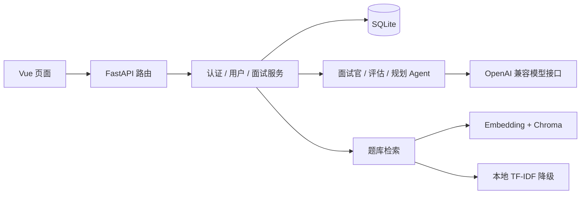

# 系统架构

## 模块边界

| 目录 | 职责 |
| --- | --- |
| `backend/api/routes` | HTTP 接口、请求依赖和响应模型衔接 |
| `backend/services` | 会话、面试与用户画像业务逻辑 |
| `backend/database` | SQLAlchemy 模型、连接和初始化 |
| `backend/schemas` | Pydantic 输入输出契约 |
| `agents` | 语言模型调用、面试角色、记忆与 LangGraph 状态图 |
| `rag` | 题库规范化、检索、MMR 与提示词缓存 |
| `frontend/src/api` | 请求封装、会话与错误处理 |
| `frontend/src/components` | 页面视图与图表 |

## 请求链路

FastAPI 是业务 API 的唯一入口，Express 仅承载 Vite 或静态页面。前端通过配置的 API 地址直接请求 FastAPI，并携带 Bearer 会话令牌。

面试状态主要由 `backend/services/interview_service.py` 和数据库管理。`agents/orchestrator.py` 提供 LangGraph 协调器，但不能据此认定所有 HTTP 面试流程都完整经过该状态图；实际调用以业务服务为准。

Agent 采用懒初始化；初始化失败或调用异常时，业务服务可返回降级题目或评估。RAG 的主路径尝试 Embedding + Chroma，失败时使用 TF-IDF。服务可响应不代表外部模型已成功接通，在线效果需单独验证。
