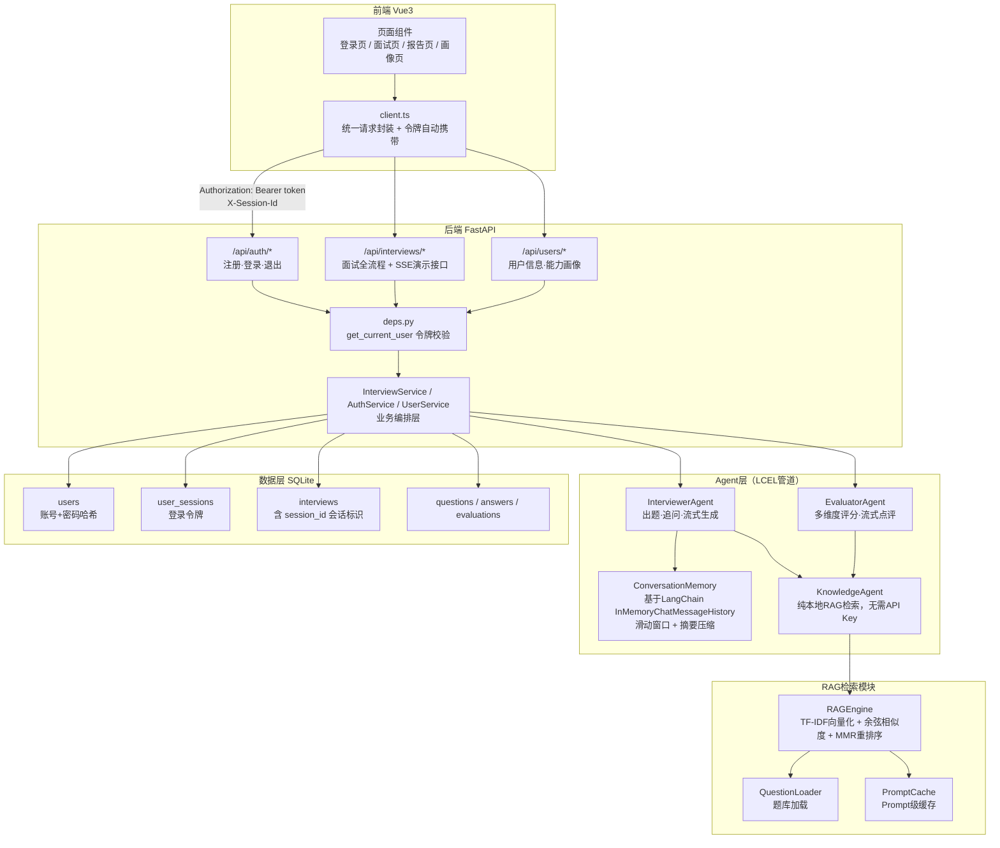

# 技术文档 / 项目说明书

**项目名称**：面试突破助手
**文档版本**：v1.0
**编写人**：成员E（测试与文档专员，综合团队各模块产出整理）
**最后更新**：2026-07-25

---

## 一、项目概述

面试突破助手是一个基于 **RAG检索 + Multi-Agent架构** 的智能模拟面试系统，帮助用户练习技术面试、发现薄弱环节并获得针对性改进建议。

### 1.1 核心能力

- **智能出题**：面试官Agent结合目标公司/职位/技术栈，生成贴合场景的面试题目
- **智能追问**：当回答不够充分时，AI自动生成针对性追问，而非机械进入下一题
- **多维度评估**：评估Agent从准确性、完整性、逻辑性、表达能力四个维度打分，并给出具体点评
- **RAG知识库**：题库检索支持多样性重排序（MMR）、来源标注，答案生成有真实题库/标准答案作为参考依据
- **账号体系与会话隔离**：完整的注册登录，不同账号数据严格隔离
- **流式输出**：出题、点评均支持SSE流式（打字机效果）展示

---

## 二、技术栈

| 层次 | 技术选型 |
|---|---|
| 后端框架 | Python + FastAPI |
| Agent框架 | LangChain 1.x（LCEL管道：`prompt \| llm \| parser`）+ LangGraph（状态机编排） |
| 大模型 | DeepSeek（通过`langchain-openai`兼容接口调用） |
| RAG检索 | 自研TF-IDF + 余弦相似度（MMR多样性重排序），详见第五节 |
| 数据库 | SQLite + SQLAlchemy |
| 认证 | bcrypt密码哈希 + 自定义会话令牌（非JWT，见第四节说明） |
| 前端 | Vue3 + TypeScript + axios |
| 测试 | pytest（含pytest-asyncio支持异步流式测试） |

---

## 三、系统架构图

### 架构说明

- **前后端数据流转**：前端`client.ts`统一封装所有请求，自动在请求头携带登录令牌（`Authorization: Bearer <token>`）和会话标识（`X-Session-Id`），业务组件本身不关心这些细节。
- **认证与权限校验**：`deps.py`中的`get_current_user`是所有需要登录的接口的公共依赖项，负责验证令牌有效性、反查真实用户身份；每个涉及面试数据的接口都会额外校验"这份数据是否属于当前登录用户"（归属校验），防止跨账号越权访问。
- **Agent层与LCEL管道**：`InterviewerAgent`、`EvaluatorAgent`内部核心生成逻辑均通过`agents/base.py`提供的`_build_chain()`构建`prompt | llm | parser`形式的LCEL管道（`RunnableSequence`对象），支持`.invoke()`同步调用和`.astream()`流式调用两种模式，分别对应"一次性返回"和"SSE打字机效果"两种业务场景。
- **对话记忆**：`ConversationMemory`基于LangChain内置的`InMemoryChatMessageHistory`实现，采用滑动窗口机制（保留最近N轮问答）并支持摘要压缩，避免超长对话导致的token溢出问题。
- **RAG检索**：`RAGEngine`对外提供`search()`（基础检索，被`KnowledgeAgent`实际调用）和`search_with_mmr()`（多样性重排序）两个接口，底层用TF-IDF向量化+余弦相似度计算完成"向量化入库、相似度检索"，具体技术选型理由见第五节。

---

## 四、认证与会话隔离设计

### 4.1 设计目标

老师新增要求项目具备真实的注册登录功能，并实现"会话隔离"。设计上，我们把这两个需求合并处理：**登录成功后颁发一个与账号绑定的会话令牌，之后所有请求携带这个令牌，后端据此验证身份、隔离数据**，让"会话隔离"从字面意义上真正落到实处，而不只是记录一个匿名UUID。

### 4.2 数据模型

- `users`表：`id`、`username`（唯一）、`password_hash`（bcrypt哈希，不存明文）
- `user_sessions`表：`id`、`token`（随机生成，64位十六进制字符串）、`user_id`、`created_at`、`expires_at`（7天有效期）

### 4.3 认证流程

1. 注册/登录成功后，`AuthService`生成一个随机令牌（`secrets.token_hex(32)`），写入`user_sessions`表，返回给前端
2. 前端将令牌存入`sessionStorage`（随浏览器标签页关闭而失效，符合"仅当前会话有效"的语义），后续所有请求自动携带
3. 后端`get_current_user`依赖函数从请求头解析令牌，查表反查用户身份，未找到或已过期则返回401
4. 退出登录时删除对应的`user_sessions`记录，令牌立即失效

### 4.4 权限隔离设计

除了登录校验，所有涉及具体面试数据的接口（开始面试、提交回答、跳过问题、查询状态、查询总结、SSE演示接口）都额外执行"归属校验"——查询该面试记录的`user_id`是否等于当前登录用户的`id`，不匹配则返回403。面试列表、能力画像等聚合类接口，同样强制以登录身份而非请求参数中的id作为筛选依据，避免任何"传参冒充他人"的可能。

**为什么不用JWT**：考虑到项目规模和"退出登录立即失效"这一需求（JWT本身是无状态的，要支持主动失效通常需要额外维护黑名单，反而更复杂），选择了更直接的数据库会话表方案，效果等价且实现更简单。

---

## 五、RAG检索模块设计

### 5.1 检索流程

文档加载（`QuestionLoader`）→ 文本分割 → TF-IDF向量化 → 余弦相似度计算 → （可选）MMR多样性重排序 → 返回结果（含来源标注`source`和元数据`metadata`）。

### 5.2 关于"向量化"实现方式的说明

本项目检索核心使用**TF-IDF（词频-逆文档频率）+ 余弦相似度**完成"向量化入库、相似度检索"，而非调用外部Embedding模型+向量数据库（如ChromaDB）。这是团队权衡后的主动选择：

1. TF-IDF本身就是一种向量化方法——将每条文档转换为高维稀疏向量，检索时计算查询向量与文档向量的余弦相似度，符合"向量化+相似度检索"的标准流程，只是向量构造方式不依赖神经网络Embedding。
2. 题库规模可控（十余道结构化面试题），TF-IDF检索质量足够，且不需要额外调用Embedding API，离线也能稳定演示。
3. 在此基础上完整实现了MMR多样性重排序、检索结果来源标注、题目元数据管理，这些是考核标准"优秀线"的要求，说明团队在这个方向上是有完整投入的。
4. 架构上预留了升级空间：`RAGEngine`对外接口与真正接入ChromaDB+Embedding模型后保持一致，后续切换不影响调用方代码。

（详细版本见`docs/RAG_DELIVERY.md`）

### 5.3 MMR多样性重排序

`search_with_mmr()`按"相关性 - 多样性惩罚"的公式迭代选择结果，避免返回的多条题目内容高度重复。测试阶段发现并修复了该方法内部的下标类型错误与候选池未按相关性排序的问题（详见`docs/TEST_REPORT.md` ISSUE-A），修复后功能真实可用。

---

## 六、SSE流式输出设计

### 6.1 设计动机

考核标准要求实现SSE流式输出，同时也能提升实际使用体验（出题、点评过程能实时看到文字生成，而不是等待数秒后一次性出现）。

### 6.2 实现方式

- **Agent层**：`agents/base.py`的`_astream_chain()`封装了LCEL管道自带的`.astream()`方法，逐块（chunk）产出文本；`InterviewerAgent.generate_question_stream()`、`EvaluatorAgent.generate_feedback_stream()`基于此实现。
- **接口层**：新增两个独立的SSE演示接口（`/preview-question/stream`、`/preview-feedback/stream`），使用FastAPI的`StreamingResponse`，`media_type="text/event-stream"`，不影响原有正式业务接口（`/start`、`/answer`）的返回格式和数据库写入逻辑。
- **前端**：`client.ts`提供通用的`readSSEStream()`读取器，用`fetch`获取的`ReadableStream`按SSE协议（`data: {...}\n\n`）解析出一条条JSON消息，按`type`字段（`chunk`/`score`/`done`/`error`）分发给业务回调函数，在`InterviewView.vue`中接入到"提交回答→展示评估面板"的真实业务流程——分数/维度/优缺点保持真实数据不变，仅点评文字部分用打字机效果逐字展示。

### 6.3 评估流式化的特殊处理

评估结果本质是结构化JSON（分数、维度等），无法像纯文本那样边生成边展示（半截JSON无法解析）。因此设计上分两步：先一次性计算出真实评分（同步返回`score`事件），再针对已算出的评分结果，额外生成一段自然语言点评并流式输出（`chunk`事件），兼顾了数据准确性和流式体验。

---

## 七、测试与质量保障

累计44个自动化测试用例，覆盖健康检查、认证与会话隔离、多用户数据隔离、面试全流程、SSE流式接口、Agent层（含LCEL管道验证）、RAG检索、全链路集成8大模块，全部通过。详见`docs/TEST_REPORT.md`（执行结果）与`docs/TEST_CASES.md`（用例设计）。

测试过程中额外发现并修复了2处此前未被真实业务路径触发过的问题：RAG模块MMR重排序的下标类型错误、对话记忆模块重构后遗留的测试签名不匹配，均已修复并通过复测。

---

## 八、已知限制

- LangSmith等外部LLM调用追踪工具目前未接入。
- RAG核心检索为TF-IDF方案，非真实Embedding向量检索（原因见第五节）。
- 依赖版本已锁定精确号码，但暂无自动化的开发/生产环境配置分离（当前仅一套`.env`配置）。
- 部分`backend/schemas/`下的Pydantic模型仍使用V2中已标记废弃的`class Config`写法，Pydantic V3发布后需要迁移至`ConfigDict`（不影响当前功能）。

---

## 九、启动与使用说明

详见`docs/USER_MANUAL.md`，包含环境准备、依赖安装、启动步骤、完整API调用示例与常见问题解答。